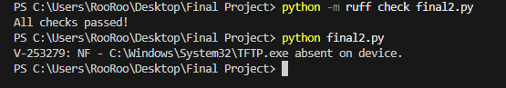
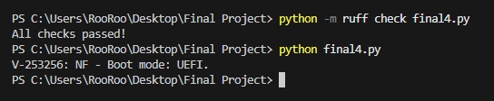
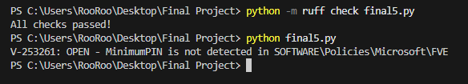

[Back to Portfolio](./)

Final Project - 5 STIG Python Script
===============

-   **Class:** Survey of Scripting Languages - CSCI 301
-   **Grade:** 100%
-   **Language(s):** Python
-   **Source Code Repository:** [STIG final link](https://github.com/Pookie-Roo/STIG-Final/tree/main)  
    (Please [email me](mailto:aslittle@student.csuniv.edu?subject=GitHub%20Access) to request access.)

## Project description

This program is a compilation of five scripts written in Python covering STIG standards on a Window's system. While you can do these in several different languages, I wrote mine in Python as it is usually the language used, and I wanted more practice with it. The first STIG is to check if structured exception handling overwrite protection is enabled. The second one checks if the TFTP Client is installed or not. The third one makes sure only authorized users accounts are allowed to create and run virtual machines on Windows 11. The fourth STIG checks if Windows 11 Unified Extensible Firmware Interface and configured in UEFI mode instead of Legacy BIOS. The last one checks if the system has a BitLocker PIN with a minimum length of six digits.

## How to compile and run the program

First, the user will need to download the files from the repository. Then they will need to open the terminal and cd into the directory where the script is. Then the user types:

**python -m ruff check (script_name).py**

This makes sure that all checks in the code pass and there are no errors. If that returns "All checks passed!", run the script with this command:

**python (script_name).py**

## UI Design

Each of the STIG scripts are designed to either tell the user that the condition it is looking for is true or through out an error message if the condition is false. If the condition is true, the output will say "NF" and then state the condition asked. If the condition is false, the output will say "OPEN" and then state that the intended condition is not true or that a path could not be found in some cases.

  
Fig 1. The 2nd python script running

  
Fig 2. The 4th python script running

  
Fig 3. The 5th python script running

For more details see [GitHub Flavored Markdown](https://guides.github.com/features/mastering-markdown/).

[Back to Portfolio](./)
