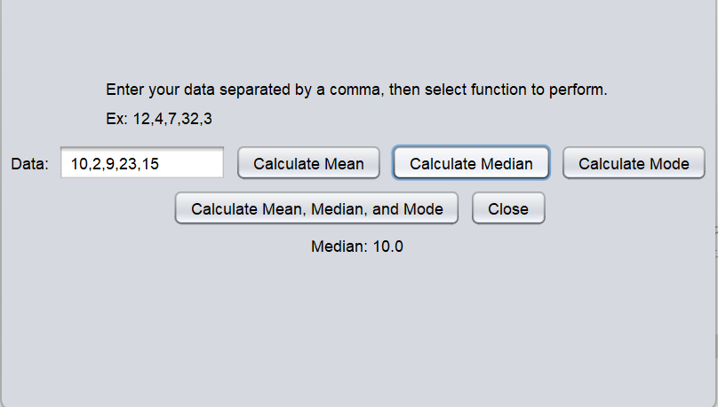
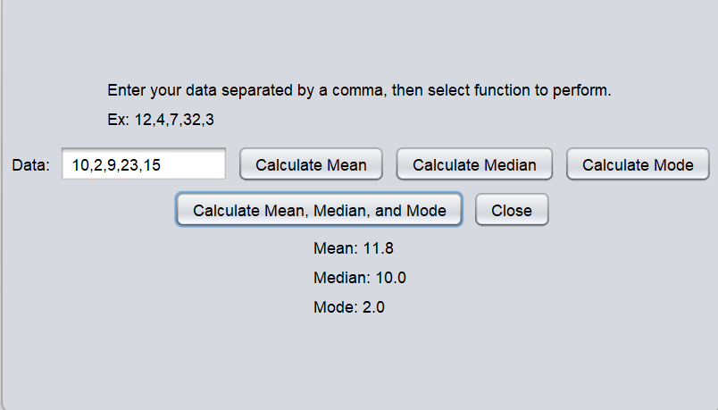

[Back to Portfolio](./)

Statistics Calculator
===============

-   **Class:** Object-Oriented Programming - CSCI 325
-   **Grade:** 100%
-   **Language(s):** Java
-   **Source Code Repository:** [features/mastering-markdown](https://guides.github.com/features/mastering-markdown/)  
    (Please [email me](mailto:aslittle@student.csuniv.edu?subject=GitHub%20Access) to request access.)

## Project description

This program is a statistics calculator with GUI created in Netbeans. The program prompts the user to input a set of values, separated by commas, so they can calculate the mean, median, mode, or all three at once, of the inputted set. The program is designed to ignore commas and whitespace once the user has pressed one of the calculation buttons. It puts the string of numbers the user inputted into an array, converts them into an array of doubles, then calculates with the array of doubles.

## How to compile and run the program

How to compile (if applicable) and run the project.

```bash
cd ./project
python setup.py
```

If the programming language does not require compilation, the update the heading to be “How to run the program.” If your application is deployed on a remote service, including instructions on how to deploy it.

## UI Design

Once the user starts the program, they will see a box that allows them to input a set of values of their choice, separated by commas. There are also four boxes that allow the user to calculate either the mean, the median, the mode, or all three at once. The program is designed to make it to where the user can calculate all four without needing to replace the input. Once the user presses one of the buttons, the output will appear towards the bottom of the window. Finally, there is another button labelled "cancel" that will allow the user to exit the program.

  
Fig 1. Calculating the mean of the input.

  
Fig 2. Calculating the median of the input.

  
Fig 3. Calculating the mean, median, and mode at once.


For more details see [GitHub Flavored Markdown](https://guides.github.com/features/mastering-markdown/).

[Back to Portfolio](./)
