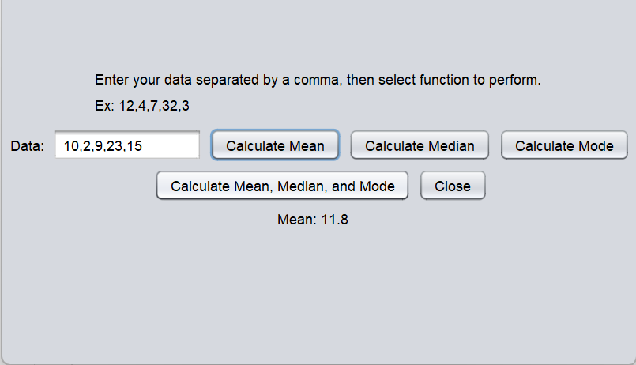

[Back to Portfolio](./)

Statistics Calculator
===============

-   **Class:** Object-Oriented Programming - CSCI 325
-   **Grade:** 100%
-   **Language(s):** Java
-   **Source Code Repository:** [features/mastering-markdown](https://guides.github.com/features/mastering-markdown/)  
    (Please [email me](mailto:aslittle@student.csuniv.edu?subject=GitHub%20Access) to request access.)

## Project description

This program is a statistics calculator with GUI created in Netbeans. When running the program, the user will see a box where they can type in inputs separated by commas, buttons to find the mean, median, mode, and all three of the inputted values, and a "cancel" button that allows the user to exit out of the program. The program is designed to ignore commas and whitespace once the user has pressed one of the calculation buttons. It puts the string of numbers the user inputted into an array, converts them into an array of doubles, then calculates with the array of doubles.

## How to compile and run the program

How to compile (if applicable) and run the project.

```bash
cd ./project
python setup.py
```

If the programming language does not require compilation, the update the heading to be “How to run the program.” If your application is deployed on a remote service, including instructions on how to deploy it.

## UI Design

Almost every program requires user interaction, even command-line programs. Include in this section the tasks the user can complete and what the program does. You don't need to include how it works here; that information may go in the project description or in an additional section, depending on its significance.

Lorem ipsum dolor sit amet (see Fig 1), consectetur adipiscing elit, sed do eiusmod tempor incididunt ut labore et dolore magna aliqua. Ut enim ad minim veniam, quis nostrud exercitation ullamco laboris nisi ut aliquip ex ea commodo consequat (see Fig 2). Duis aute irure dolor in reprehenderit in voluptate velit esse cillum dolore eu fugiat nulla pariatur. Excepteur sint occaecat cupidatat non proident, sunt in culpa qui officia deserunt mollit anim id est laborum (see Fig 3).

  
Fig 1. Calculating the mean of the input.

  
Fig 2. Calculating the median of the input.

  
Fig 3. Calculating the mean, median, and mode at once.


For more details see [GitHub Flavored Markdown](https://guides.github.com/features/mastering-markdown/).

[Back to Portfolio](./)
