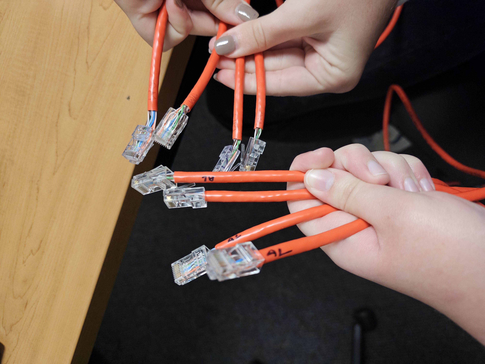
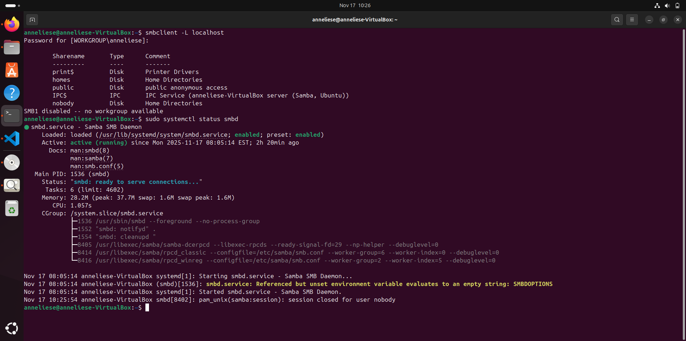
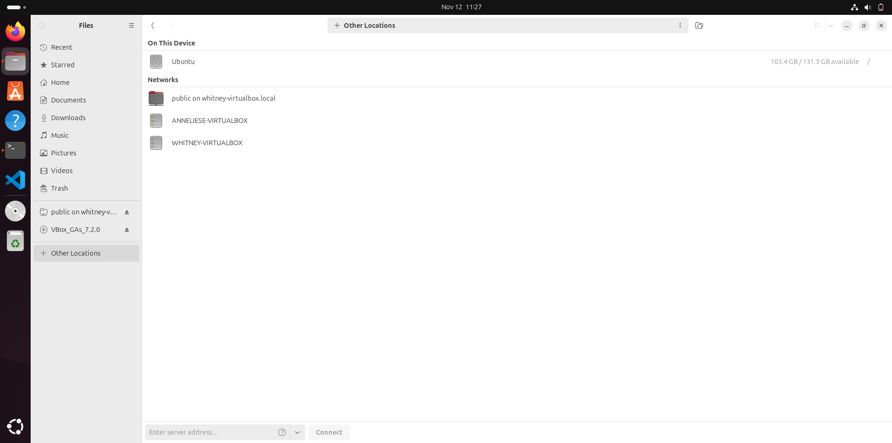

[Back to Portfolio](./)

Creating a LAN
===============

-   **Class:** Applied Networking - CSCI 332
-   **Grade:** 100%
-   **Language(s):** HTML
-   **Source Code Repository:** [Website Detailing LAN Creation](https://github.com/Pookie-Roo/LAN-Lab)  
    (Please [email me](mailto:aslittle@student.csuniv.edu?subject=GitHub%20Access) to request access.)

## Project description

Unlike the other projects, this is not not a traditional program. There is a little snippet of code in HTML to create a website that explains the details of this lab. So while there is not much challenging code, this project leans more towards my major, Cybersecurity, and was still very challenging. To complete this lab, first, my partner and I had to construct two ethernet cables each by untwisting the cords in the cable, arranging them in the correct color order, and connecting a head to them. Then we configured the router and connected them to our laptops. Next, we downloaded and set up samba on our Ubuntu virtual machines. Finally, we set up a file to transfer to each other's laptops.

## How to start the website

## UI Design

Upon opening this lab on the overall website, the user will see a table of content to got to different sections of the lab. Clicking the section I link will keep the user on that same page that has our names, group number, and the table of content. The section II link will take the user to the page where I explain how we created our cables with pictures attached. The link to section III takes the user to the explanation about getting my samba up and running, as well as the router configuration. The fourth and final link takes the user to the full explanation of constructing the LAN, from the connection of our laptops to the router to the actual transferring of the file.

  
Fig 1. The ethernet cables my partner and I put together

  
Fig 2. Samba downloaded and set up on my machine

  
Fig 3. Our laptops synced via the cables and router

For more details see [GitHub Flavored Markdown](https://guides.github.com/features/mastering-markdown/).

[Back to Portfolio](./)
