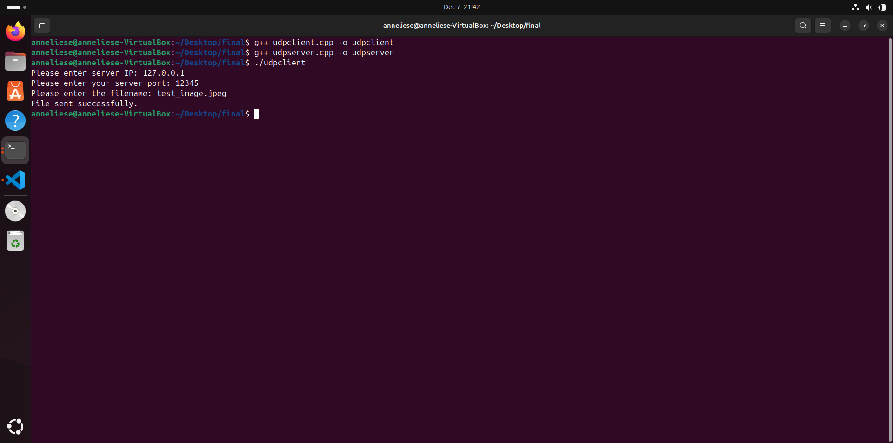

[Back to Portfolio](./)

Final Project - UDP Client and Server Package Transfer
===============

-   **Class:** Applied Networking - CSCI 332
-   **Grade:** 100%
-   **Language(s):** C++
-   **Source Code Repository:** [UDP Client and Server Transfer](https://github.com/Pookie-Roo/UDP-Client-Server/tree/main)  
    (Please [email me](mailto:aslittle@student.csuniv.edu?subject=GitHub%20Access) to request access.)

## Project description

This program is a compilation of five scripts written in Python covering STIG standards on a Window's system.

## How to compile and run the program

For this project, make sure to open two separate terminals, one for the client and one for the server. To compile, run these two commands on the respective terminals:

**g++ Client.cpp -o Client** and **g++ Server.cpp -o Server**

Once the two codes are compiled, run these commands to start the programs:

**.\Client** and **.\Server**

## UI Design

Almost every program requires user interaction, even command-line programs. Include in this section the tasks the user can complete and what the program does. You don't need to include how it works here; that information may go in the project description or in an additional section, depending on its significance.

Lorem ipsum dolor sit amet (see Fig 1), consectetur adipiscing elit, sed do eiusmod tempor incididunt ut labore et dolore magna aliqua. Ut enim ad minim veniam, quis nostrud exercitation ullamco laboris nisi ut aliquip ex ea commodo consequat (see Fig 2). Duis aute irure dolor in reprehenderit in voluptate velit esse cillum dolore eu fugiat nulla pariatur. Excepteur sint occaecat cupidatat non proident, sunt in culpa qui officia deserunt mollit anim id est laborum (see Fig 3).

  
Fig 1. The file successfully transferring on the client side

  
Fig 2. The file successfully transferring on the server side

For more details see [GitHub Flavored Markdown](https://guides.github.com/features/mastering-markdown/).

[Back to Portfolio](./)
