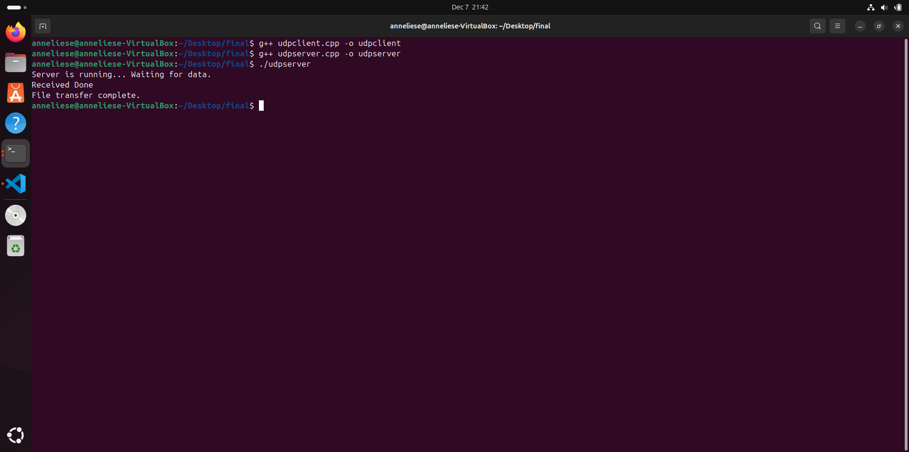

[Back to Portfolio](./)

Final Project - UDP Client and Server Package Transfer
===============

-   **Class:** Applied Networking - CSCI 332
-   **Grade:** 100%
-   **Language(s):** C++
-   **Source Code Repository:** [UDP Client and Server Transfer](https://github.com/Pookie-Roo/UDP-Client-Server/tree/main)  
    (Please [email me](mailto:aslittle@student.csuniv.edu?subject=GitHub%20Access) to request access.)

## Project description

This program acts as a client and server completing a handshake over UDP. The code was written in Visual Studio Code on an Ubuntu Linux virtual machine. The program is set to run locally on the IP address 127.0.0.1. It is also designed to transfer over port 12345. The user will be prompted to input these two as well as what file they would like to transfer on the client and only the listening port on the server. Once they hit enter on both, the transfer will begin. This only works for small files. The client sends the packet in bytes. With each byte received, the server will send an acknowledgement to the client, which makes it request to send the next byte. Once the whole file has been transferred, both the client and server will output "done," and the handshake will be complete. The server will also send an acknowledgement to "output.txt" and closes the file and socket.

## How to compile and run the program

For this project, make sure to open two separate terminals, one for the client and one for the server. To compile, run these two commands on the respective terminals:

**g++ udpclient.cpp -o udpclient** and **g++ udpserver.cpp -o udpserver**

Once the two codes are compiled, run these commands to start the programs:

**.\udpclient** and **.\udpserver**

## UI Design

Once the program is compiled and run, nothing needs to be done on the server side. The server will simply start listening for a handshake. On the client side, the user will be prompted to input an IP address, which is suggested to use 127.0.0.1 if local or the IP address will need to be found if not local, a port which needs to be 12345, and the name of the file the user wishes to transfer. The server will acknowledge that the file was received. Then both the client and server end the handshake by saying the file transfer was successful. Do not be alarmed if the terminal does not output every byte transferred, it is still transferring properly.

  
Fig 1. The file successfully transferring on the client side

  
Fig 2. The file successfully transferring on the server side

For more details see [GitHub Flavored Markdown](https://guides.github.com/features/mastering-markdown/).

[Back to Portfolio](./)
